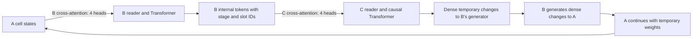

# Attention between the transformers

The November 2 controlled per-step study is complete. Structured B+C averaged
43.080% blank accuracy, versus 43.061% for larger B, 43.132% for B only, and
43.005% for pooled B+C. Its primary difference was +0.019 percentage points,
conditional 95% interval [-0.071, +0.118]. C still has no established advantage
over the B controls. A matched exploratory timing control scored 42.797% with
the old cadence, versus 43.080% per step; that difference was +0.283 points,
conditional interval [+0.019, +0.563]. See
[the per-step report](results/per_step_comparison_20261102_v4/report.md).

As of November 2, the model default generates fresh C-to-B and B-to-A weight
changes before **every reasoning call**, including native warm-up calls. H3/L6
therefore has 21 generations per ACT and 336 per full puzzle. See
[the cadence correction](PER_STEP_WEIGHTS.md) and its separate engineering
checks. The controlled results below used the earlier `per_act` cadence: one
set of weights held over the final seven calls. They do not establish how the
new cadence performs; those results are reported separately above.

The controlled three-seed test is complete. Structured attention averaged
**41.716% blank-cell accuracy**, versus **41.726%** for the parameter-matched
larger B, **41.806%** for trained pooled reads, and **41.791%** for B alone.
Its primary difference was **-0.009 percentage points**, with conditional 95%
paired-puzzle interval **[-0.090, +0.071]**. This bounded frozen-A experiment did
not establish a useful advantage from the structured reader. See
[the full controlled report](results/cross_attention_test_20261030/report.md).

Each of 12 runs completed 240 updates at batch 32, with 480 matched augmented
training puzzles per arm from a 1,536-puzzle pool. All three seeds used the same
128 held-out test puzzles. Runtime was 18.32 minutes against a 30-minute cap;
108 local tests and 874 saved-artifact checks passed. Earlier engineering smoke
evidence remains below and is separate from this controlled test.

The structured-read variant implements attention at both controller boundaries:



B already has four cross-attention heads that read A's per-cell hidden states,
changes, predictions and constraint features. Its four queries are processed by
two Transformer blocks, then a per-puzzle memory cell.

C's new cross-attention reader receives 14 B tokens with explicit identities:

- Four query tokens at B's reader output / encoder input.
- Four query tokens after B's first Transformer block.
- Four query tokens after B's second Transformer block.
- B's memory vector and final normalized readout, one token each.

C has four learned queries and four cross-attention heads. Its queries depend on
its own previous state and current ACT step. Keys and values come from projected
B tokens plus stage and query-slot embeddings. C's separate four-head causal
self-attention processes its recent attended observations. These internal tokens
are continuous vectors; they are not generated reasoning text or raw individual
B-head outputs.

The attention read selects information from B. A nonlinear generator then writes
a dense temporary change to B's generation-head weight. B uses that weight to
generate A's temporary changes. Attention flows upward and weight feedback flows
downward, with no same-step circular dependency. A, B and C retain their own
ordinary internal attention modules as well.

The implementation uses multi-head query/key/value attention as described in
[Attention Is All You Need](https://arxiv.org/abs/1706.03762). Separate heads have
the capacity to use different information; meaningful head specialization must
be measured. Read weights alone do not explain an answer or establish reasoning.

## Local configuration and evidence

`local_lab/config_cross_attention_smoke.json` selects `meta_cross_attention=true`,
`meta_cross_heads=4` and `meta_read_queries=4`. The previous summary-reader C is
preserved with `meta_cross_attention=false`. No low-rank factors are used at
either write boundary. The existing 3% A-update and 10% B-update Frobenius limits
and per-puzzle reset rules remain in force.

```powershell
& '..\plastic-latent-lab\.venv\Scripts\python.exe' -m pytest -q
& '..\plastic-latent-lab\.venv\Scripts\python.exe' -m local_lab.dense_smoke --config local_lab/config_cross_attention_smoke.json
& '..\plastic-latent-lab\.venv\Scripts\python.exe' scripts/verify_stacked_smoke.py --run results/dense_cross_attention_smoke_20261030
```

The smoke is limited to eight B/C updates, batch four and 300 seconds. A stays
frozen. It evaluates C off, shuffled C writes, phase-only C, reset C history,
pooled B tokens and B tokens shuffled across puzzles. The last two conditions
use the same C parameters and change what its cross-attention reader receives.
These are inference ablations, not separately trained matched baselines.

`initial_cross_attention.pt` records per-head C read weights, source tokens and
their stage/slot IDs for one sampled initial-evaluation ACT. Unit checks verify
that C can distinguish token changes with an unchanged pooled summary, that all
four cross-heads can receive answer-loss gradients, that exposing B's layer
states preserves its encoder computation, and that the path respects label and
per-puzzle boundaries.

## Executed local checks, October 30

- **105 tests passed** in 13.45 seconds, including preservation of B's encoder
  computation while exposing its internal states.
- The full-width eight-update smoke completed in **98.50 seconds**, against its
  300-second cap, with peak Torch CUDA allocation of 553.07 MiB.
- B has 348,128 learned parameters; the structured C has 29,168. Each of C's
  four cross-attention heads received finite nonzero answer-loss gradients on
  every update.
- Disabling C reproduced the corresponding standalone A/B model bit for bit.
  All 15 native A tensors stayed identical to the donor checkpoint.
- Saved-artifact verification passed **98/98 checks**, including attention
  dimensions, per-head normalization, source-stage coverage, gradient records,
  checkpoint tensors, and metrics recomputed from saved predictions.

These are engineering and inference-ablation checks on four admitted training
puzzles and eight separate validation puzzles. A performance advantage or useful
head specialization has not been established. Saved results are in
`results/dense_cross_attention_smoke_20261030/report.md`, `summary.json`,
`initial_cross_attention.pt`, `artifact_verification.json` and `unit_checks.json`.
