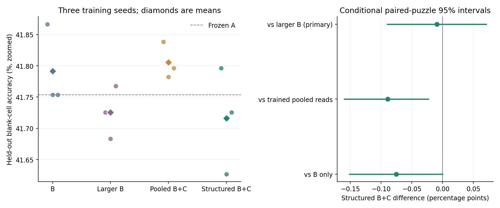

# Tiny Recursive Models: Adaptive Controllers

A research fork of [Samsung SAIL Montreal's Tiny Recursive Models](https://github.com/SamsungSAILMontreal/TinyRecursiveModels), exploring whether transformers can control other transformers through temporary weight changes.

The upstream model, code, and attribution are preserved. The original project introduction and benchmark instructions are in [UPSTREAM_README.md](UPSTREAM_README.md). This fork's bounded experiments are separate from the upstream paper's benchmark results.

## What this fork adds

- **A** is the native Tiny Recursive Model, solving 9 x 9 Sudoku through recurrent latent and answer updates.
- **B** reads A's hidden-state trajectory and generates temporary, per-puzzle changes to two of A's MLP weight matrices.
- **C** reads B and changes B's weight-generation head before B generates A's changes. The structured variant uses cross-attention over B's internal layer tokens.
- Matched controls, controller ablations, isolated A-weight adaptation probes, tests, saved measurements, and experiment reports.

The current dense architecture generates complete temporary matrices. Earlier low-rank controller experiments remain available as research history. Inference-time updates do not overwrite the stored base weights.

## Results so far

The completed three-seed, frozen-A attention study did **not** establish an accuracy advantage for structured inter-model attention over a parameter-matched larger B.

| System | Mean blank-cell accuracy |
| --- | ---: |
| B only | 41.791% |
| Larger B, parameter matched | 41.726% |
| B + C, pooled reads | 41.806% |
| B + C, structured attention | 41.716% |

These measurements use the same 128 held-out Sudoku puzzles and one frozen A donor. No evaluated variant solved a complete puzzle. The primary structured-attention versus larger-B difference was -0.009 percentage points, with a conditional paired-puzzle 95% interval of [-0.090, +0.071]. This interval does not capture uncertainty from retraining A.



See the [full controlled report](results/cross_attention_test_20261030/report.md) for the protocol, budgets, per-seed results, ablations, and limitations. Earlier joint-training studies also did not show a consistent adaptability advantage over their static controls.

## Start reading

| Document | Scope |
| --- | --- |
| [Inter-model attention](INTER_MODEL_ATTENTION.md) | Current A/B/C attention architecture and controlled study |
| [Dense weight generation](DENSE_ARCHITECTURE.md) | B directly generates complete temporary changes to A |
| [Stacked controllers](STACKED_ARCHITECTURE.md) | C changes B's generator, then B changes A |
| [Longer experiment](LONGER_EXPERIMENT.md) | Native, static, and dynamic joint training, followed by fresh-controller probes |
| [Initial experiment](LOCAL_EXPERIMENT.md) | Earlier native-TRM controller study and data protocol |

Implementation lives in `models/recursive_reasoning/trm_{plastic,dense,stacked,comparison}.py`; runners are in `local_lab/`, tests in `tests/`, and evidence checks in `scripts/`.

## Install and run the tests

The recorded environment used Python 3.12 and a CUDA-enabled PyTorch build. Exact local dependency versions are in [local_lab/requirements-local.txt](local_lab/requirements-local.txt); that file specifies CUDA 12.8 wheels. The local runners use the included portable AdamATan2 implementation instead of requiring its compiled CUDA extension.

From the repository root:

```bash
python -m venv .venv
# Linux/macOS:
source .venv/bin/activate
# Windows PowerShell instead:
# .\.venv\Scripts\Activate.ps1

python -m pip install -r local_lab/requirements-local.txt
python -m pytest -q
```

The unit suite uses small synthetic fixtures and does not need downloaded Sudoku data or saved model checkpoints. It currently contains 108 tests. The native source-training runner requires CUDA; follow-up runner budgets and recorded timings come from the local GPU environment.

## Reproduce an experiment

The Git repository includes source, configurations, reports, plots, JSON measurements, source snapshots, and compact per-puzzle metrics. Downloaded Sudoku pools, raw prediction bundles, and all `.pt` artifacts, including trained checkpoints and tensor evaluation dumps, are excluded. Saved verification receipts describe the original local audits; repeating the complete tensor audits requires regenerating those omitted artifacts.

1. Prepare the pinned expanded Sudoku pool. This command downloads data from the source recorded by `local_lab.data` and writes a local provenance manifest:

   ```bash
   python -m local_lab.data --root data/local-expanded-sudoku --train-size 65536 --val-size 2048 --test-size 1024
   ```

2. Copy `local_lab/config_longer.json` to `local_lab/config_longer_repro.json`. Set `name` to `longer_sudoku_repro` and `results_dir` to `results/longer_sudoku_repro`, then run:

   ```bash
   python -m local_lab.train --config local_lab/config_longer_repro.json
   ```

   This generates `checkpoints/longer_sudoku_repro/native.pt` alongside the static and dynamic arms. Retraining produces a new donor; it does not guarantee the original measurements.

3. For the controlled attention comparison, copy `local_lab/config_attention_test.json` to `local_lab/config_attention_repro.json`. Set:

   - `source_checkpoint`: `checkpoints/longer_sudoku_repro/native.pt`
   - `results_dir`: `results/cross_attention_repro`
   - `profile_file`: `results/cross_attention_profile_repro.json`

   Then run:

   ```bash
   python -m local_lab.attention_test --config local_lab/config_attention_repro.json --stage all
   python scripts/verify_attention_test.py --run results/cross_attention_repro
   python -m local_lab.attention_report --run results/cross_attention_repro
   ```

Use a fresh output directory for each run: runners protect existing results against overwrites. Historical documents and saved reports sometimes show the original machine's interpreter or paths; use your activated environment's `python` command and paths inside your checkout.

## Attribution and licenses

The native TRM implementation comes from Samsung SAIL Montreal's [Less is More: Recursive Reasoning with Tiny Networks](https://github.com/SamsungSAILMontreal/TinyRecursiveModels). Its original [MIT license](LICENSE) is retained.

The portable optimizer derives from AdamATan2. Its [Apache-2.0 license](third_party/adam_atan2_0_0_3/LICENSE), original sources, and [provenance](third_party/adam_atan2_0_0_3/provenance.json) are included. Sudoku dataset identity, revision, and source terms are recorded separately by the data-preparation pipeline; the upstream code license is not asserted to license that dataset.
