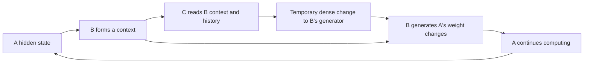

# C modifies B; B modifies A

The richer inter-model attention variant is documented in
[INTER_MODEL_ATTENTION.md](INTER_MODEL_ATTENTION.md). It gives C four explicit
cross-attention heads over B's internal layer tokens. This document also retains
the original summary-reader variant and its separate smoke evidence below.

`models/recursive_reasoning/trm_stacked.py` adds a third Transformer C to the
direct dense architecture. A solves Sudoku. B reads A's hidden trajectory and
generates temporary dense changes to two of A's weight matrices. C reads B's
current 64-dimensional context, previous context and changes, its own previous
state and a four-step causal history. C generates a complete temporary change
to B's 1024 by 32 generator output weight.



The within-step order is explicit: first B forms a context, then C modifies B's
generator, then B generates the next A changes. C has no direct A write port.
The default now repeats this chain before every native reasoning call, including
warm-up: 21 times per ACT and 336 times per full H3/L6 puzzle. C's four-step
history consequently spans reasoning calls. The original October 30 run below
used one late action per ACT; its configuration keeps that historical cadence
explicit. See [PER_STEP_WEIGHTS.md](PER_STEP_WEIGHTS.md) for the correction.
The experiment modifies B's generation head, rather than all of B's weights.
All updates are generated densely, without low-rank factors. Chunking is only an
output/memory strategy. During inference the stored A and B base tensors stay
unchanged; functional temporary updates affect their computation.

## Attention in each model

All three models already have their own multi-head attention modules. Counts
below are per attention module, not counts of controller levels.

| Model | Hidden width | Transformer blocks | Attention heads | Width per head | Attends to |
|---|---:|---:|---:|---:|---|
| A | 512 | 2 shared, recurrent | 8 | 64 | Sudoku and puzzle-embedding token states |
| B | 64 | 2 | 4 | 16 | Cross-attention reads A's per-cell states and constraint features; self-attention mixes B's four read queries |
| C | 32 | 1 | 4 | 8 | Causal self-attention over four B-context observations, including state changes and C's previous state |

A's `num_heads`, B's `dense_controller_heads` and C's
`meta_controller_heads` are explicit in `local_lab/config_stack_smoke.json`.
A uses the pretrained checkpoint's original attention layout. Changing its
head count would reinterpret pretrained computation and requires a separate
experiment. B and C are independently configured; each hidden width must be
divisible by its head count.

The weight-generation **output head** modified by C is a separate component
from these attention heads. Heads are not assigned human-readable roles or
assumed to provide explanations of the reasoning process.

C's per-matrix Frobenius limit is 10% of B's generation-head norm; B's A updates
retain their 3% limits. These are numerical limits and are not behavioral safety
guarantees. Neither controller receives answer labels as observations. Both have
independent per-puzzle runtime state, reset for new puzzles. B observations into
C are detached, and gradient credit through history is truncated between ACT
updates. Answer-loss gradients still flow through A's temporary computation,
B's generated matrices, and C's temporary modification of B.

`set_meta_mode("off")` recovers the same A/B computation, checked bit for bit.
C modes also include `dynamic`, `phase`, `shuffle`, and `reset_memory`.
`configure_hierarchy` supports B/C joint training, C-only training with A/B
frozen, and A/B/C gradients. The smoke trains B and C with A frozen; it does not
run a new joint A/B/C performance experiment.

```powershell
& '..\plastic-latent-lab\.venv\Scripts\python.exe' -m pytest -q
& '..\plastic-latent-lab\.venv\Scripts\python.exe' -m local_lab.dense_smoke --config local_lab/config_stack_smoke.json
& '..\plastic-latent-lab\.venv\Scripts\python.exe' scripts/verify_stacked_smoke.py
```

The new configuration loads the earlier dense A/B smoke checkpoint, adds fresh
C, and has eight B/C updates with a 240-second cap. Existing runs are never
overwritten; use a fresh results directory for another run. The official test
split and privileged oracle are not used.

The saved C-off, shuffled, phase-only and memory-reset rows are inference
ablations of one jointly trained checkpoint. A matched B-only training arm,
equally larger B, multiple seeds and held-out adaptation probes are still needed
to establish whether stacking helps. Module tests include C-off identity, the
C-to-B-to-A gradient path, per-puzzle isolation, partial resets, label independence,
norm/rank bounds, optional joint gradients and exception cleanup.

## Verified local run, October 30

- B: 348,128 parameters. C: 25,456 additional parameters.
- Full suite: **96 tests passed** in 14.71 seconds, including 13 new hierarchy cases.
- Eight B/C updates completed with A frozen in **85.46 seconds**, against a
  240-second cap. Peak Torch CUDA allocation was 552.95 MiB.
- The sampled C update was 1024 by 32 with full column rank 32. Saved-artifact
  verification passed 83 checks, including all 15 A tensors unchanged, actual
  B/C parameter changes, matrix bounds/ranks and prediction-derived metrics.
- Final blank-cell accuracy on the eight validation puzzles was 42.478% with C
  and 42.257% with C disabled; untouched A was 42.478%. These very small smoke
  measurements do not establish a performance advantage from stacking.

Saved evidence is in `results/dense_stack_smoke_20261030/report.md`,
`summary.json`, `artifact_verification.json` and `unit_checks.json`.
