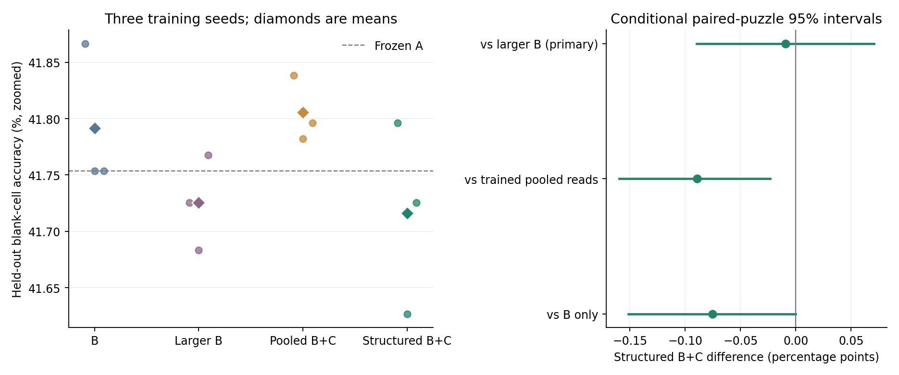

# Controlled test of inter-model attention

**This run did not establish an accuracy advantage for structured inter-model attention over the parameter-matched larger-B control.**

The predeclared primary comparison is structured B+C versus an active,
parameter-matched larger B. Its mean difference was **-0.009
percentage points**, with conditional paired-puzzle 95% interval
**[-0.090, +0.071]**.

## Final held-out results

Blank-cell accuracy is evaluated on 128 official test puzzles at
offset 768, using all 16 ACT updates per puzzle. Frozen A alone
scored **41.754%**. Controller results average seeds [29, 43, 59].

| Trained system | Trainable parameters | Blank-cell accuracy | Task loss |
|---|---:|---:|---:|
| B only | 348,128 | 41.791% | 1.380661 |
| Larger B, parameter matched | 377,296 | 41.726% | 1.380407 |
| B+C, pooled reads | 377,296 | 41.806% | 1.380761 |
| B+C, structured attention | 377,296 | 41.716% | 1.380652 |

| System | Seed 29 | Seed 43 | Seed 59 |
|---|---:|---:|---:|
| B only | 41.867% | 41.754% | 41.754% |
| Larger B, parameter matched | 41.726% | 41.683% | 41.768% |
| B+C, pooled reads | 41.838% | 41.782% | 41.796% |
| B+C, structured attention | 41.796% | 41.627% | 41.726% |

No evaluated variant produced a complete valid puzzle solution.



## Protocol and executed budget

A was fixed at the same native-training checkpoint for every run. The experiment
does not train A or test whether joint A training makes A more adaptable. B writes
complete dense temporary changes to A's two MLP down-projections. C cross-attends
to 14 internal B tokens and writes a dense temporary change to B's generation
head. There are no low-rank factors in the tested models.

Each of the 12 training runs received **240 updates**, batch
**32**, identical data/augmentation and native A-call budgets
within each seed. This admitted **480 augmented puzzles per arm** from
a 1536-puzzle pool. Pooled and structured C had exactly identical
initial parameters. The larger-B control spent C's 29,168-parameter budget on
an active context network, rather than unused parameter padding. Its total
trainable count exactly matches B+C. Total FLOPs and wall-clock costs are not
identical; the matched compute boundary is the number of A calls.

The 64-puzzle development panel and held-out test panel are disjoint
from controller training. Hyperparameters and the primary comparison were fixed
before study evaluation. A training-only throughput profile selected
240 updates from a requested 256 to respect
the **30-minute cap**, with a 50% timing margin. Profile
models were discarded. Every reported checkpoint is the final training step;
development scores were not used to choose checkpoints. No oracle was used.

The comparison completed in **18.32 minutes**.
All 12 arms completed. The local suite passed 108 tests before the
run. The independent saved-artifact audit passed **874/874**
checks, including all native A tensors unchanged, common initialization,
regenerated augmented streams, exact parameter matching, snapshot hashes,
prediction-derived accuracy and independently calculated Stablemax task loss.
The auditor does not replay optimizer steps or model inference.

## Paired effects and inference ablations

Positive values favor normal structured B+C. C ablations use the same trained
checkpoint and do not replace separately trained controls. The pooled trained
arm is the matched experiment for whether the structured read interface helps.

| Comparison | Mean difference (pp) | Conditional 95% interval (pp) |
|---|---:|---:|
| cross-minus-larger_b | -0.009 | [-0.090, +0.071] |
| cross-minus-pooled | -0.089 | [-0.160, -0.023] |
| cross-minus-b | -0.075 | [-0.151, +0.000] |
| cross-minus-c_off | -0.028 | [-0.113, +0.057] |
| cross-minus-c_write_shuffle | -0.066 | [-0.151, +0.019] |
| cross-minus-c_read_shuffle | -0.066 | [-0.155, +0.019] |
| cross-minus-c_read_pooled | -0.056 | [-0.138, +0.024] |
| cross-minus-c_phase | -0.085 | [-0.165, -0.009] |
| cross-minus-c_reset_memory | -0.052 | [-0.122, +0.014] |

The intervals resample held-out puzzles after averaging these three fixed seeds.
They do not capture uncertainty from retraining A or the full distribution of
controller training outcomes. Secondary intervals are descriptive and are not
adjusted for multiple comparisons. Only one A donor, a bounded controller budget
and one Sudoku test panel were evaluated. Nonzero attention gradients or distinct
attention maps do not demonstrate useful specialization, reasoning transparency
or safety. Exact-puzzle results and each inference condition remain in summary.json.

## Reproduction

Copy `local_lab/config_attention_test.json` with fresh `results_dir` and
`profile_file` paths; existing runs are never overwritten. Then run:

```powershell
& '..\plastic-latent-lab\.venv\Scripts\python.exe' -m local_lab.attention_test --config local_lab/config_attention_test.json --stage all
& '..\plastic-latent-lab\.venv\Scripts\python.exe' scripts/verify_attention_test.py
& '..\plastic-latent-lab\.venv\Scripts\python.exe' -m local_lab.attention_report
```
