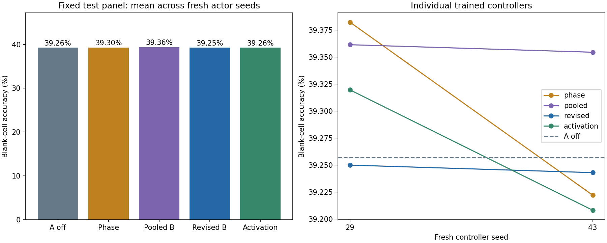

# Frozen-A gate oracle and revised-controller experiment

Saved status: **complete**. Measured oracle/training/evaluation execution: **528.3 seconds**, bound 1500 seconds. Frozen substrate: `checkpoints/longer_sudoku/joint.pt`; source A and learned U/V directions remain unchanged.

Controller-stage peak CUDA tensor allocation: 3.834 GiB. This excludes driver/other-process memory and is not a dedicated latency benchmark.

This is an intervention/interface experiment on one previously joint-trained A checkpoint. It does not train A, introduce a new task family, perform meta-learning, or establish increased A-weight adaptability. Two fresh controller seeds are conditional on the same A and puzzle panels.

Primary revised-B minus learned-schedule test contrast: **-0.056 percentage points**, conditional paired puzzle interval [-0.136, +0.025]. The conditional paired interval includes zero; this pilot does not demonstrate an accuracy advantage for revised B over the learned schedule.

## Privileged gate oracle

The oracle sees answers to 32 separately reserved diagnostic puzzles (or the configured smoke size). It optimizes eight bounded gates in the terminal seven-call reasoning window, starting from a common untouched A trajectory. Zero is always an eligible candidate, and each puzzle retains its best measured task-loss action. This is finite local search, not a proved global or full-trajectory upper bound. These scores are not deployed-controller scores.

| Action interface | Baseline blank accuracy | Local oracle blank accuracy | Mean task-loss reduction | Nonworsening loss per example |
| --- | ---: | ---: | ---: | --- |
| weight | 36.648% | 36.538% | 0.006995 | True |
| activation | 36.648% | 36.593% | 0.005398 | True |

The oracle optimizes blank Stablemax cross-entropy plus 0.25 times given-clue cross-entropy. Lower cross-entropy need not improve argmax accuracy. A small or negative accuracy change limits claims about the usefulness of this action space; it does not prove that every possible gate sequence is ineffective.

## Nonprivileged test results

Training uses 768 source-A-untrained puzzles; development uses 128; oracle diagnostics use 32 separate puzzles. The final fixed test panel contains 256 official held-out puzzles. All panels have disjoint puzzle IDs and hashes. Test and development evaluation never calls the oracle.

| Controller | Blank accuracy | Exact puzzle | Given agreement | Stablemax per cell | Task objective |
| --- | ---: | ---: | ---: | ---: | ---: |
| Frozen A, no adjustments | 39.257% | 0.000% | 100.000% | 1.022499 | 1.467733 |
| Learned ACT-step schedule | 39.302% | 0.000% | 100.000% | 1.022467 | 1.467682 |
| Matched pooled-reader B | 39.358% | 0.000% | 100.000% | 1.021276 | 1.465947 |
| Cell-aware B with persistent memory | 39.246% | 0.000% | 100.000% | 1.021625 | 1.466462 |
| Matched activation controller | 39.264% | 0.000% | 100.000% | 1.021629 | 1.466482 |

Trainable-arm values are equal-weight means across the configured fresh controller seeds; the no-adjustment computation is deterministic and evaluated once. Fixed final checkpoints are used, with no development-best or test-best selection. Development scores and every per-seed endpoint remain in summary.json.

| Paired test contrast | Mean revised-B gain (pp) | Per-seed gains (pp) | Conditional puzzle interval (95%, pp) |
| --- | ---: | --- | --- |
| revised-minus-off | -0.010 | 29: -0.007, 43: -0.014 | [-0.101, +0.080] |
| revised-minus-phase (primary) | -0.056 | 29: -0.132, 43: +0.021 | [-0.136, +0.025] |
| revised-minus-pooled | -0.112 | 29: -0.112, 43: -0.112 | [-0.217, -0.007] |
| revised-minus-activation | -0.017 | 29: -0.070, 43: +0.035 | [-0.136, +0.098] |
| revised-minus-shuffle | +0.007 | 29: +0.021, 43: -0.007 | [-0.063, +0.080] |
| revised-minus-phase_only | -0.049 | 29: -0.042, 43: -0.056 | [-0.136, +0.042] |
| revised-minus-reset_memory | +0.021 | 29: +0.000, 43: +0.042 | [-0.035, +0.077] |

Descriptive paired bootstrap over test puzzles, averaging these fixed controller seeds before resampling. No independent A-training replicates or controller-training uncertainty; secondary intervals have no multiple-comparison adjustment.

Shuffle rolls actions between the examples of each evaluation batch. Phase-only suppresses the revised model's content residual while still computing it; this is a same-checkpoint intervention, distinct from the independently trained schedule. Reset-memory zeros only the GRU state at each ACT update; previous latent/prediction/action features remain available.

## Architecture and matching

Each ACT update retains native H3/L6: 14 untouched no-gradient calls followed by one action held over seven differentiable calls. All training and evaluation use fixed ACT16; there is no learned-halting exposure confound. Native A weights, U/V, puzzle embeddings, constants and buffers are frozen. The controller sees no targets: it reads cell-level latent states, their changes, candidate probabilities, entropy, clues, soft row/column/box count residuals, the previous action and the ACT-step embedding. Four attention queries read the 81-cell tokens, two width-96 Transformer blocks process them, and a width-96 GRU retains within-puzzle memory. Memory values persist across ACT updates but gradients truncate between optimizer steps; fresh puzzle slots reset all runtime history.

The pooled-reader arm uses identical neural parameters/memory but averages the token representations. The activation arm uses the same controller, output dimensions and U directions; a label-free training-activation RMS calibration supplies constant coefficients instead of token-dependent xV. Both projection forms execute xV, but calibration does not guarantee identical realized perturbation norms or identical function classes. The schedule uses a global eight-value action plus sixteen eight-value ACT-step residuals.

All trainable arms use the same task loss and periodic training-only oracle-imitation targets, with equal local-search budgets. Thus the comparison does not give revised B additional answer access. The teacher searches only training examples; separate diagnostic-oracle and evaluation labels never enter actor training. The oracle itself is a privileged optimization routine, not a deployable controller.

| Seed | Arm | Completed updates | Trainable parameters | Puzzle admissions | Unique training puzzles | Teacher calls | Training seconds |
| --- | --- | ---: | ---: | ---: | ---: | ---: | ---: |
| 29 | phase | 300/300 | 136 | 1,216 | 629 | 18 | 51.6 |
| 29 | pooled | 300/300 | 402,192 | 1,216 | 629 | 18 | 46.1 |
| 29 | revised | 300/300 | 402,192 | 1,216 | 629 | 18 | 46.2 |
| 29 | activation | 300/300 | 402,192 | 1,216 | 629 | 18 | 45.8 |
| 43 | phase | 300/300 | 136 | 1,216 | 616 | 18 | 44.4 |
| 43 | pooled | 300/300 | 402,192 | 1,216 | 616 | 18 | 46.6 |
| 43 | revised | 300/300 | 402,192 | 1,216 | 616 | 18 | 46.8 |
| 43 | activation | 300/300 | 402,192 | 1,216 | 616 | 18 | 46.4 |

| Controller | Gate RMS | Between-puzzle gate variance fraction | Realized adapter/base output RMS ratio |
| --- | ---: | ---: | ---: |
| Frozen A, no adjustments | 0.00000 | 0.00000 | 0.000000 |
| Learned ACT-step schedule | 0.19758 | 0.00000 | 0.002961 |
| Matched pooled-reader B | 0.86835 | 0.01010 | 0.013387 |
| Cell-aware B with persistent memory | 0.59350 | 0.16601 | 0.009241 |
| Matched activation controller | 0.88761 | 0.12339 | 0.013817 |

Variation alone is not a benefit: compare the held-out controls and the same-checkpoint interventions. Unique puzzle counts are shared across matched arms and cannot be summed as independent training examples. Equal actor/A-call/search budgets do not equalize all wall-time or every FLOP with the much smaller phase/no-adjustment controls.

## Verification and practical limits

Independent verification: **1464/1464 passed**. Independent saved-tensor equality, frozen buffers, actor learning, oracle accounting, training-only teacher IDs/budgets, source/data hashes, ZIP CRCs and metrics recomputed from saved predictions. Does not independently rerun model inference or reconstruct every optimizer step.

Local unit tests: **67 passed** (5.47 seconds), with a completed full-width integration preflight.

The source is still an early-learning Sudoku model, the fixed rank-four directions may offer little useful control, and there is only one A donor and two fresh actor seeds. The actor search, teacher budget, shallow temporal credit and small validation/test panels limit general conclusions. This pilot tests a revised controller at a shared frozen interface; it cannot adjudicate whether larger learned interfaces or explicit episodic meta-training would work.



## Reproduce locally

```powershell
$python = 'G:\Projects\TransformerLab\plastic-latent-lab\.venv\Scripts\python.exe'
& $python -m local_lab.frozen_run --config local_lab/config_frozen.json --stage oracle
& $python -m local_lab.frozen_run --config local_lab/config_frozen.json --stage controllers
& $python scripts/verify_frozen_run.py --run-dir results/frozen_A_pilot_20261029
& $python -m local_lab.frozen_report --run-dir results/frozen_A_pilot_20261029
```

Run outputs are protected against overwrites. Use a fresh results_dir in a copied configuration. Runtime sources are preserved separately for the oracle and controller stages; reports do not load Torch or rerun inference.
