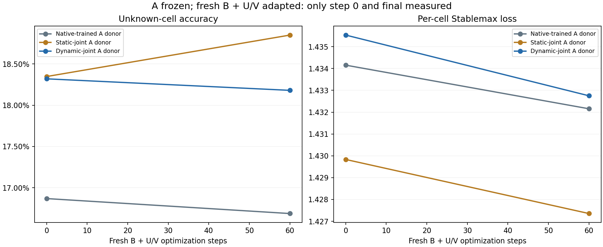

# Isolated A-weight probe with fresh B and adapter factors

Fresh-B test-panel unknown-cell accuracy, step 0 → final: Native-trained A donor 16.87% → 16.69%; Static-joint A donor 18.35% → 18.85%; Dynamic-joint A donor 18.32% → 18.18%. This is same-task readaptation on new Sudoku instances, conditional on one source A-training seed and one fresh-B seed. The dynamic-joint A donor shows no consistent adaptability advantage over the static-joint donor in this bounded run.

The source models and their completed early-learning comparison are documented in the separate [source-training report](../local_sudoku/report.md).

This report is separate from the source-training comparison. It transplants native A's inner state from each raw source donor while excluding the low-rank adapter factors. A's weights, constants, and puzzle-embedding table are frozen. Each arm receives the same fresh B, U/V factors, static gates, and other non-A initial state. B and the fresh U/V factors train; all native A tensors remain frozen. Thus the donor intervention changes only A while the complete trainable small interface starts identically. This is broader than training B alone.

Adaptation uses the 384 previously unused validation-pool puzzles after the first 128 source-evaluation puzzles. Training-only legal Sudoku augmentations are new views of those puzzles. The test panel remains the same first 128 official-test-prefix puzzles. This tests readaptation within Sudoku, not an unfamiliar task family or a held-out graph-composition/path-length shift.

Saved status: `complete`. Fresh-B seed: `29`. Wall time: 75.9 seconds of 300. All recorded probe evaluations use raw weights; EMA is not mixed into this probe.

Peak CUDA tensor allocation: 2.27 GiB. This excludes driver and other-process allocation.

## Step-0 state and learning changes

Unknown-cell gains subtract each donor arm's own initial score. Stablemax reduction is initial minus final loss. Different initial A capabilities can create different headroom, so final scores, initial scores, and changes must be interpreted together. Only step 0 and the final probe checkpoint are evaluated; this does not identify a detailed learning-speed curve or an observed multi-checkpoint gain AUC.

| A donor | Test puzzles | Recorded steps | Initial unknown-cell acc | Final unknown-cell acc | Gain (pp) | Initial Stablemax | Final Stablemax | Stablemax decrease | Final exact-puzzle acc |
| --- | --- | --- | --- | --- | --- | --- | --- | --- | --- |
| Native-trained A donor | 128 | [0, 60] | 16.87% | 16.69% | -0.181 | 1.4342 | 1.4322 | +0.00200 | 0.00% |
| Static-joint A donor | 128 | [0, 60] | 18.35% | 18.85% | +0.502 | 1.4298 | 1.4274 | +0.00248 | 0.00% |
| Dynamic-joint A donor | 128 | [0, 60] | 18.32% | 18.18% | -0.140 | 1.4355 | 1.4327 | +0.00278 | 0.00% |

Positive paired values below favor the dynamic-joint A donor over the indicated source donor:

| Comparator donor | Initial unknown-cell advantage (pp) | Final unknown-cell advantage (pp) | Extra unknown-cell gain (pp) | Final Stablemax advantage | Extra Stablemax decrease |
| --- | --- | --- | --- | --- | --- |
| Native-trained A donor | +1.451 | +1.493 | +0.042 | -0.00059 | +0.00078 |
| Static-joint A donor | -0.028 | -0.670 | -0.642 | -0.00539 | +0.00030 |

An endpoint advantage inherited entirely from step 0 is not an improvement in adaptation. A larger reduction from a worse initial loss is also not sufficient without a useful final result. The source models remain early in learning and have not demonstrated complete Sudoku solving; this limits conclusions about learned adaptability.

## Isolation and exposure checks

| Recorded check | Passed |
| --- | --- |
| all three donor arms recorded | True |
| all probe stages complete | True |
| equal executed steps | True |
| common fresh non A initialization | True |
| A hashes unchanged | True |
| puzzle embeddings unchanged | True |
| all native buffers unchanged | True |
| same candidate streams | True |
| all test endpoints use 16 ACT steps | True |
| evaluation state unchanged | True |
| evaluation gates cleared | True |
| three matched step 0 final panels | True |

All recorded isolation/matching checks passed: **True**. Actual admitted augmentation streams equal: **True**. Native ACT can make actual admissions model-dependent even when proposed candidates match. Checkpoint hashes are saved evidence; independent verification scope is stated separately below.

| A donor | Steps | New puzzle admissions | Unique adaptation puzzles | Adaptation-pool coverage | Distinct augmentation views | ACT-slot presentations | Trainable B + U/V parameters | Seconds |
| --- | --- | --- | --- | --- | --- | --- | --- | --- |
| Native-trained A donor | 60/60 | 256 | 203 | 52.86% | 256 | 3,840 | 826,120 | 18.1 |
| Static-joint A donor | 60/60 | 256 | 203 | 52.86% | 256 | 3,840 | 826,120 | 13.6 |
| Dynamic-joint A donor | 60/60 | 256 | 203 | 52.86% | 256 | 3,840 | 826,120 | 14.3 |

Equal probe steps match native A reasoning work, not total source-training history or all model FLOPs. Source and probe exposure are separate; repeated ACT slots and augmented views do not create independent puzzles or optimization seeds.

Lines connect the two measured endpoints for readability; intermediate test scores were not measured.

Saved independent verification passed: **True** across 139 checks. Scope: No-Torch source/data/file-integrity, recorded protocol/accounting consistency, metric identities and paired step-0/final gains. Actual tensor equality and A-only transplants require the separate tensor verifier; actual admission decisions have no independent per-step ledger.

Separate actual-tensor verification passed: **True**, with 448/448 checks. Scope: Independent checkpoint tensor comparisons: complete native A copied from donors and frozen, common fresh B/U/V without donor interface reuse, actual tensor hashes and expected learning. Nonpersistent runtime buffers and predictions are not reconstructed from checkpoints.

| A donor | Changed A tensors | Changed B tensors | Changed U/V tensors | Changed static gates |
| --- | --- | --- | --- | --- |
| Native-trained A donor | 0 | 43 | 4 | 0 |
| Static-joint A donor | 0 | 43 | 4 | 0 |
| Dynamic-joint A donor | 0 | 43 | 4 | 0 |

Shared final local validation records **49 tests passed** in 3.98 seconds. Portable optimizer parity and probe isolation tests are included; the reporter does not rerun them.

## Limits

One source-training seed and one fresh-controller seed provide descriptive evidence. Donor differences can reflect ordinary source capability as well as a representation's compatibility with the common fresh low-rank interface. The probes do not establish broad plasticity, robust retention, task-family transfer, or statistical significance. No explicit counterfactual-action distillation or persistent memory is introduced. A strong learning-to-adapt conclusion would require more learned A donors, independent training seeds, intermediate probe checkpoints, and controlled new-task shifts.

`probe_report_summary.json` retains per-donor endpoint changes and paired contrasts. `probe_report_manifest.json` hashes saved evidence and reporter code. This report imports no Torch and runs no model.
