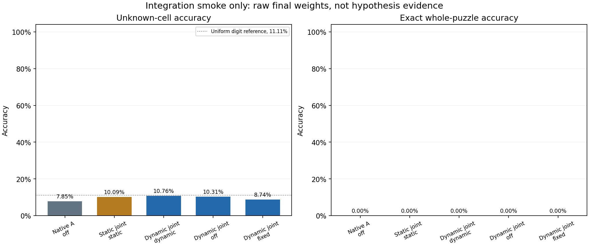
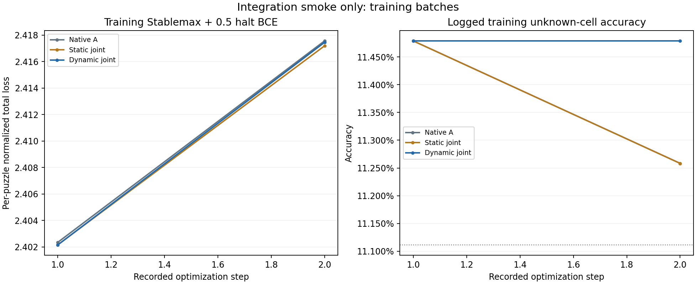

# Local native TRM and controller B

**Integration smoke only; its short scores are not hypothesis evidence.** Raw final test-panel scores: Native A 7.85% unknown-cell / 0.00% exact-puzzle; Static joint 10.09% unknown-cell / 0.00% exact-puzzle; Dynamic joint 10.76% unknown-cell / 0.00% exact-puzzle. This run measures early from-scratch Sudoku learning with native TRM and our plasticity controller. It does not measure isolated A-weight adaptability, and it does not reproduce the paper's final benchmark accuracy.

Saved status: `complete`. Seed: `17`. Wall time: 48.6 seconds. Configured bound: 240 seconds.

A retains native width 512 and two shared reasoning layers. Each ACT inner update uses H=3 outer cycles and L=6 latent updates, giving 21 shared-module calls: 14 without gradients and seven with gradients. Carries detach between ACT updates, and evaluation retains the native maximum of 16 ACT updates. Our B uses width 128, three causal Transformer layers, eight heads, FF width 512, and history four; it controls rank-four temporary updates on the two native MLP down-projections at scale 0.2. B's history resets per ACT inner update. The preserved executed configuration and sources establish the actual settings.

Native A-only, static joint, and dynamic joint arms start from the same full state and receive the same proposed candidate stream. Native ACT decides which slots admit new puzzles, so actual admissions are checked separately. Stablemax, halt BCE, AdamATan2, sparse puzzle-embedding optimization, and EMA follow the local runner's native setup. Dynamic-checkpoint gates-off/fixed evaluations are counterfactual inference modes, not independently trained controls.

Recorded native A dense parameters: **6,828,034**. Our B parameters: **809,736**. The separately optimized native puzzle-embedding table has 512 elements; its batch-local gradient buffer has 4,096 elements, which are not additional logical puzzle-embedding degrees of freedom. Dense optimizer: Portable PyTorch implementation of adam-atan2 0.0.3 upstream reference formula; fused CUDA build unavailable on Windows. Native sparse optimizer: CastedSparseEmbeddingSignSGD_Distributed, world_size=1.

The saved pool contains 512 validation and 512 test puzzles. Endpoint evaluations use the first **8** puzzles of each pool, fixed across arms, modes, and weight versions. These are prefix panels, not full-pool scores. Evaluation batch size: 8.

## Saved evaluations

Unknown-cell accuracy excludes given clues. Exact accuracy requires the whole saved target solution. Given agreement measures copied clues; valid-grid fraction requires a completed legal Sudoku that also preserves all givens. All-cell accuracy includes copied clues and can look strong when unknown cells remain wrong. The clue-copy baseline exposes that inflation. A uniform guess over nine digits gives an 11.11% unknown-cell reference, rather than a trained solver.

| Arm | Weights | Mode | Split | Puzzles | Unknown-cell acc | Exact puzzle acc | Given agreement | Valid grids | All-cell acc | Clue-copy baseline | Stablemax per cell |
| --- | --- | --- | --- | --- | --- | --- | --- | --- | --- | --- | --- |
| Native A | raw | off | val | 8 | 9.15% | 0.00% | 11.00% | 0.00% | 9.72% | 30.86% | 2.5725 |
| Native A | raw | off | test | 8 | 7.85% | 0.00% | 9.90% | 0.00% | 8.49% | 31.17% | 2.4922 |
| Native A | ema | off | val | 8 | 9.15% | 0.00% | 9.00% | 0.00% | 9.10% | 30.86% | 2.5470 |
| Native A | ema | off | test | 8 | 9.64% | 0.00% | 13.86% | 0.00% | 10.96% | 31.17% | 2.4856 |
| Static joint | raw | static | val | 8 | 11.38% | 0.00% | 15.00% | 0.00% | 12.50% | 30.86% | 2.4890 |
| Static joint | raw | static | test | 8 | 10.09% | 0.00% | 10.40% | 0.00% | 10.19% | 31.17% | 2.5336 |
| Static joint | ema | static | val | 8 | 7.37% | 0.00% | 10.50% | 0.00% | 8.33% | 30.86% | 2.5278 |
| Static joint | ema | static | test | 8 | 8.07% | 0.00% | 9.90% | 0.00% | 8.64% | 31.17% | 2.5445 |
| Dynamic joint | raw | dynamic | val | 8 | 10.94% | 0.00% | 10.00% | 0.00% | 10.65% | 30.86% | 2.5299 |
| Dynamic joint | raw | dynamic | test | 8 | 10.76% | 0.00% | 10.89% | 0.00% | 10.80% | 31.17% | 2.4907 |
| Dynamic joint | ema | dynamic | val | 8 | 10.71% | 0.00% | 12.00% | 0.00% | 11.11% | 30.86% | 2.5593 |
| Dynamic joint | ema | dynamic | test | 8 | 9.19% | 0.00% | 12.38% | 0.00% | 10.19% | 31.17% | 2.5151 |
| Dynamic joint | raw | off | val | 8 | 9.38% | 0.00% | 9.50% | 0.00% | 9.41% | 30.86% | 2.5025 |
| Dynamic joint | raw | off | test | 8 | 10.31% | 0.00% | 8.91% | 0.00% | 9.88% | 31.17% | 2.4929 |
| Dynamic joint | raw | fixed | val | 8 | 10.04% | 0.00% | 9.00% | 0.00% | 9.72% | 30.86% | 2.4728 |
| Dynamic joint | raw | fixed | test | 8 | 8.74% | 0.00% | 5.45% | 0.00% | 7.72% | 31.17% | 2.5627 |

Evaluation checkpoint policy: raw fixed final; EMA also evaluated separately with mu=0.999.

Raw final weights are primary. EMA is secondary and is kept separate in every table; its native rate of 0.999 can lag substantially in a short from-scratch run. No raw/EMA averaging occurs. Endpoint loss is normalized per-cell Stablemax loss. Training curves log per-puzzle normalized Stablemax task loss plus 0.5 × halting BCE on the sampled training batch. No held-out validation curve was measured during training, and no validation-best checkpoint was selected.

Raw dynamic-checkpoint interventions compare identical A/B weights and test examples. Positive gains favor evolving dynamic gates over the indicated inference mode:

| Panel | Comparator mode | Dynamic unknown-cell gain (pp) | Dynamic exact gain (pp) | Dynamic Stablemax decrease |
| --- | --- | --- | --- | --- |
| val | off | +1.562 | +0.000 | -0.02741 |
| val | fixed | +0.893 | +0.000 | -0.05707 |
| test | off | +0.448 | +0.000 | +0.00212 |
| test | fixed | +2.018 | +0.000 | +0.07199 |

## Exposure and local resources

Loader advancement, ACT batch-slot presentations, and newly admitted source puzzles are different quantities. An unhalted carry can continue an earlier puzzle. Training augmentations create new symmetry views of existing puzzles, not independent new puzzles. Use the admission and unique-source counters below to assess actual data coverage.

| Arm | Executed/requested steps | New puzzle admissions | Unique source puzzles | Distinct admitted augmentation views | ACT-slot presentations | Trainable parameters | Seconds | Complete |
| --- | --- | --- | --- | --- | --- | --- | --- | --- |
| Native A | 2/2 | 8 | 8 | 8 | 16 | 6,828,034 | 16.5 | True |
| Static joint | 2/2 | 8 | 8 | 8 | 16 | 6,844,426 | 0.5 | True |
| Dynamic joint | 2/2 | 8 | 8 | 8 | 16 | 7,654,154 | 0.9 | True |

Peak CUDA tensor allocation: 0.59 GiB. GPU: `NVIDIA GeForce RTX 5070 Ti`. Tensor allocation excludes driver and other-process memory. Timing includes whatever the runner records as stage work and is not a dedicated hardware benchmark.

| Saved matching / inference check | Passed |
| --- | --- |
| all configured arms recorded | True |
| same initial full state | True |
| all stages completed requested steps | True |
| equal completed step budgets | True |
| same proposed candidate stream | True |
| all evaluations use 16 ACT steps | True |
| evaluation parameter states unchanged | True |
| evaluation runtime gates cleared | True |
| logged training reasoning calls 21 | True |
| logged training gradient enabled calls 7 | True |
| logged training controller calls match mode | True |

All recorded matching/inference checks passed: **True**. Actual admitted puzzle streams equal: **True**. ACT admissions can differ as models halt at different times. An admission difference is a consequence of native ACT and must be considered when attributing gains; equal candidate batches alone do not establish equal realized training data.

## Data and integrity

The saved data evidence records pinned source identity, stream selection, split sizes, hashes, and integrity checks. Data labels are training/evaluation targets; B receives no solutions at inference.

```json
{
  "repository": "sapientinc/sudoku-extreme",
  "revision": "58942f96baeb572ca3127e2a9e9c70f330783d6b",
  "selection": "Official test sequential prefix first; official train sequential prefix supplies train then validation; reject invalid rows and any already-selected puzzle OR solution hash",
  "requested_sizes": {
    "train": 8192,
    "val": 512,
    "test": 512
  },
  "splits": {
    "train": {
      "n": 8192,
      "shape": [
        8192,
        81
      ],
      "official_source_split": "train",
      "original_index_min": 0,
      "original_index_max": 8191,
      "source_counts": {
        "puzzles4_forum_hardest_1905": 4292,
        "puzzles1_unbiased": 1946,
        "puzzles0_kaggle": 208,
        "puzzles5_forum_hardest_1905_11+": 88,
        "01_file1": 1546,
        "puzzles2_17_clue": 105,
        "puzzles6_forum_hardest_1106": 3,
        "puzzles3_magictour_top1465": 4
      },
      "rating_min": 0,
      "rating_max": 257,
      "valid_solution_count": 8192,
      "clue_consistent_count": 8192,
      "unique_puzzle_sha256": 8192,
      "unique_solution_sha256": 8192
    },
    "val": {
      "n": 512,
      "shape": [
        512,
        81
      ],
      "official_source_split": "train",
      "original_index_min": 8192,
      "original_index_max": 8703,
      "source_counts": {
        "puzzles1_unbiased": 141,
        "puzzles4_forum_hardest_1905": 274,
        "01_file1": 73,
        "puzzles0_kaggle": 12,
        "puzzles2_17_clue": 5,
        "puzzles5_forum_hardest_1905_11+": 6,
        "puzzles3_magictour_top1465": 1
      },
      "rating_min": 0,
      "rating_max": 213,
      "valid_solution_count": 512,
      "clue_consistent_count": 512,
      "unique_puzzle_sha256": 512,
      "unique_solution_sha256": 512
    },
    "test": {
      "n": 512,
      "shape": [
        512,
        81
      ],
      "official_source_split": "test",
      "original_index_min": 0,
      "original_index_max": 511,
      "source_counts": {
        "puzzles1_unbiased": 153,
        "puzzles4_forum_hardest_1905": 274,
        "puzzles0_kaggle": 13,
        "puzzles2_17_clue": 6,
        "01_file1": 59,
        "puzzles5_forum_hardest_1905_11+": 7
      },
      "rating_min": 0,
      "rating_max": 112,
      "valid_solution_count": 512,
      "clue_consistent_count": 512,
      "unique_puzzle_sha256": 512,
      "unique_solution_sha256": 512
    }
  },
  "encoding": {
    "pad": 0,
    "blank": 1,
    "digits_1_to_9": [
      2,
      10
    ],
    "vocab_size": 11,
    "puzzle_identifier": 0,
    "seq_len": 81
  },
  "limitations": [
    "Sequential prefixes can be source- and difficulty-biased; these are not random samples of the full official dataset.",
    "Validation is an adjacent held-out portion of the official training prefix, not a separately published benchmark split.",
    "Exact puzzle and solution hash separation is enforced; mathematical equivalence of local train/validation puzzles is not independently solved.",
    "Official card claims unique solutions and mathematically inequivalent train/test sets; local checks validate provided solutions and clues, not independent uniqueness proofs.",
    "Pool size is not training exposure; the runner must report actual base puzzles seen and repeated augmented presentations."
  ]
}
```

Saved independent verification passed: **True**. Recorded check count: 305. Scope: Independent source/data/hash/protocol/accounting and saved metric identity checks. Upstream source comparison permits Windows CRLF normalization. No Torch import; no checkpoint tensor reconstruction or independent per-step ACT admission ledger.

## Figures





## Interpretation and limits

A begins from scratch. An early dynamic/static/native difference can reflect ordinary task learning, controller dependence, initialization, optimization noise, or unequal effective work if any matching check fails. It is not an isolated test of whether A learned to become easier to adapt. This single-seed diagnostic shares its puzzle collection across arms; examples and augmented views must not be treated as independent model-training replicates.

The native README's smallest full Sudoku experiment takes about 18 hours on a 48 GB L40S. The short local 16 GB run is setup and early-learnability evidence. Paper headline accuracy, broad retention, and H3 remain unestablished. A future adaptability experiment needs a learned A, matched fresh-B A-only donor swaps, step-0 and learning-speed curves, static-joint controls, and independent A-training seeds.

Upstream references: [official code and native training protocol](https://github.com/SamsungSAILMontreal/TinyRecursiveModels), [primary paper](https://arxiv.org/html/2510.04871v1). These links describe the upstream research; the local saved evidence establishes this run's behavior.

The reporter imports no Torch, loads no model weights, performs no training, and publishes nothing. `report_summary.json` preserves normalized saved metric rows; `report_manifest.json` hashes evidence and the reporter. Original configuration, logs, data audit, checkpoints, and source snapshots remain the owning evidence.
