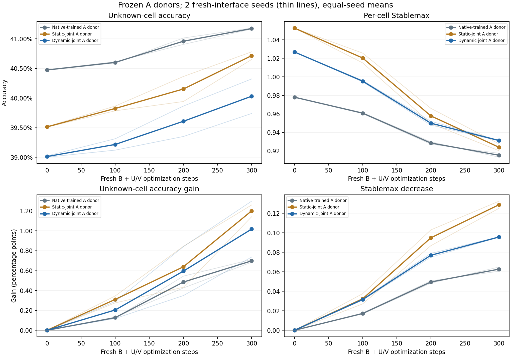

# Isolated A-weight probes across fresh-interface seeds

Across 2 fresh B/U/V seeds, mean final unknown-cell accuracy was Native-trained A donor 41.17% (gain +0.698 pp); Static-joint A donor 40.71% (gain +1.201 pp); Dynamic-joint A donor 40.03% (gain +1.018 pp). The source A-training seed and donor checkpoints are shared across these optimization runs.

Each seed resets B and the U/V factors to a common fresh state across three frozen A donors. Source B/adapters are excluded from the transplant. Within-seed contrasts compare dynamic-joint A against native-trained and static-joint A using their own initial scores and the same adaptation stream. Across seeds the fresh interface, legal augmentations, and optimization order vary; the source A donors and evaluation puzzles do not.

Means give each fresh-interface seed equal weight. They do not pool repeated test puzzles as independent observations or create independent source A-training replicates. No significance claim is made from two fresh-interface seeds.

## Mean endpoint and learning measurements

| Frozen A donor | Fresh seeds | Initial unknown-cell acc | Final unknown-cell acc | Gain (pp) | Initial Stablemax | Final Stablemax | Loss decrease | Gain AUC (pp) | Loss decrease AUC | Final exact-puzzle acc |
| --- | --- | --- | --- | --- | --- | --- | --- | --- | --- | --- |
| Native-trained A donor | [29, 43] | 40.47% | 41.17% | +0.698 | 0.9780 | 0.9153 | +0.06271 | 0.321 | 0.03270 | 0.00% |
| Static-joint A donor | [29, 43] | 39.51% | 40.71% | +1.201 | 1.0527 | 0.9239 | +0.12875 | 0.517 | 0.06384 | 0.00% |
| Dynamic-joint A donor | [29, 43] | 39.01% | 40.03% | +1.018 | 1.0269 | 0.9312 | +0.09568 | 0.436 | 0.05209 | 0.00% |

AUC uses trapezoidal relative gains over the actual common measured step grid, divided by its span. It is available only with at least three saved checkpoints. Larger loss decreases can start from worse initial loss; initial capability, final capability, within-arm gains, and static-joint comparisons must be read together.

## Paired dynamic-joint donor contrasts

Positive values favor the dynamic-joint A donor. Per-seed differences are computed before the seed mean, preserving the paired comparison.

| Fresh seed | Comparator donor | Initial acc advantage (pp) | Final acc advantage (pp) | Extra gain (pp) | Final loss advantage | Extra loss decrease | Extra gain AUC (pp) | Extra loss AUC |
| --- | --- | --- | --- | --- | --- | --- | --- | --- |
| 29 | Native-trained A donor | -1.477 | -1.424 | +0.052 | -0.01417 | +0.03488 | -0.022 | +0.01830 |
| 29 | Static-joint A donor | -0.517 | -1.040 | -0.524 | -0.01137 | -0.03698 | -0.328 | -0.01770 |
| 43 | Native-trained A donor | -1.445 | -0.859 | +0.586 | -0.01760 | +0.03106 | +0.252 | +0.02047 |
| 43 | Static-joint A donor | -0.485 | -0.328 | +0.157 | -0.00319 | -0.02917 | +0.167 | -0.00579 |

| Comparator donor | Paired seeds | Mean final acc advantage (pp) | Mean extra gain (pp) | Mean final loss advantage | Mean extra loss decrease | Mean extra gain AUC (pp) | Mean extra loss AUC |
| --- | --- | --- | --- | --- | --- | --- | --- |
| Native-trained A donor | [29, 43] | -1.141 | +0.319 | -0.01588 | +0.03297 | +0.115 | +0.01939 |
| Static-joint A donor | [29, 43] | -0.684 | -0.183 | -0.00728 | -0.03308 | -0.081 | -0.01175 |

## Actual coverage and matching

| Recorded cross-run matching check | Passed |
| --- | --- |
| all requested reports available | True |
| all probe runs complete | True |
| all per seed isolation checks passed | True |
| three donors per seed | True |
| same observed checkpoint grid | True |
| same endpoint puzzle count | True |
| same source run | True |
| actual admissions match within each seed | True |
| same adaptation pool base ids | True |
| same endpoint pool base ids | True |
| same probe training protocol | True |
| same exact source donors across seeds | True |
| distinct fresh interfaces across seeds | True |

All recorded matching checks passed: **True**. Checkpoint/pool hashes below are metadata evidence; each run's independent actual-tensor and protocol verifiers provide their stated additional checks.

| Seed | A donor | Steps | Unique adaptation puzzles | Pool coverage | Admissions | Distinct augmentation views | ACT-slot presentations | Training seconds |
| --- | --- | --- | --- | --- | --- | --- | --- | --- |
| 29 | Native-trained A donor | 300/300 | 729 | 71.19% | 1,216 | 1,216 | 19,200 | 84.2 |
| 29 | Static-joint A donor | 300/300 | 729 | 71.19% | 1,216 | 1,216 | 19,200 | 70.9 |
| 29 | Dynamic-joint A donor | 300/300 | 729 | 71.19% | 1,216 | 1,216 | 19,200 | 72.1 |
| 43 | Native-trained A donor | 300/300 | 737 | 71.97% | 1,216 | 1,216 | 19,200 | 77.1 |
| 43 | Static-joint A donor | 300/300 | 737 | 71.97% | 1,216 | 1,216 | 19,200 | 82.1 |
| 43 | Dynamic-joint A donor | 300/300 | 737 | 71.97% | 1,216 | 1,216 | 19,200 | 92.6 |

Actual unique puzzles, admissions, augmented views, and ACT slots measure different things. The same puzzle pools recur across donors and seeds, so these unique counts must not be summed as independent data. Source-training exposure is recorded in the source report and is not counted again here.

## Evidence and limits

| Fresh seed | Protocol verification passed | Protocol checks | Actual-tensor verification passed | Actual-tensor checks |
| --- | --- | --- | --- | --- |
| 29 | True | 233 | True | 940/940 |
| 43 | True | 233 | True | 940/940 |

Separate cross-seed consistency/arithmetic verification passed: **True** across 40 checks. Scope: Independent no-Torch cross-seed metadata consistency and paired metric arithmetic; actual checkpoint tensor equality has separate verification. Separate saved protocol and actual-tensor verification results are checked for passing status and reported with their own counts.. This is distinct from each run's actual-tensor verification.

Fresh seed 29: [per-seed probe report](../longer_probe_seed29/probe_report.md); status `complete`.

Fresh seed 43: [per-seed probe report](../longer_probe_seed43/probe_report.md); status `complete`.

These probes measure readaptation on new instances of the same Sudoku task. Donor starting capability, headroom, and compatibility with the common low-rank interface remain relevant. They do not establish broad plasticity, retained old-task capabilities, unfamiliar-task transfer, or a full published benchmark reproduction. Additional fresh-interface seeds do not replace independent source A-training seeds. This reporter loads no Torch or model checkpoints and runs no training.
