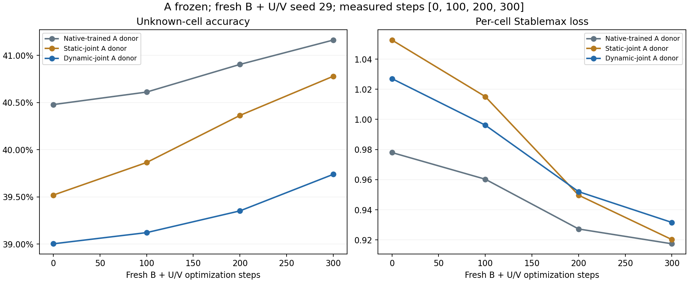

# Isolated A-weight probe with fresh B and adapter factors

Fresh-B test-panel unknown-cell accuracy, step 0 → final: Native-trained A donor 40.48% → 41.16%; Static-joint A donor 39.52% → 40.78%; Dynamic-joint A donor 39.00% → 39.74%. This is same-task readaptation on new Sudoku instances, conditional on the recorded source A-training run and fresh-interface seed 29. The dynamic-joint A donor shows no consistent adaptability advantage over the static-joint donor in this bounded run.

The source models are documented in the separate [source-training report](../longer_sudoku/report.md).

This report is separate from the source-training comparison. It transplants native A's inner state from each raw source donor while excluding the low-rank adapter factors. A's weights, constants, and puzzle-embedding table are frozen. Each arm receives the same fresh B, U/V factors, static gates, and other non-A initial state. B and the fresh U/V factors train; all native A tensors remain frozen. Thus the donor intervention changes only A while the complete trainable small interface starts identically. This is broader than training B alone.

Adaptation uses 1,024 previously unused validation-pool puzzles starting at saved offset 1,024. Training-only legal Sudoku augmentations are new views of those puzzles. The fixed endpoint contains 512 saved test puzzles. This tests readaptation within Sudoku, not an unfamiliar task family or a held-out graph-composition/path-length shift.

Saved status: `complete`. Fresh-B seed: `29`. Wall time: 443.9 seconds of 600. All recorded probe evaluations use raw weights; EMA is not mixed into this probe.

Peak CUDA tensor allocation: 2.27 GiB. This excludes driver and other-process allocation.

## Step-0 state and learning changes

Unknown-cell gains subtract each donor arm's own initial score. Stablemax reduction is initial minus final loss. Different initial A capabilities can create different headroom, so final scores, initial scores, and changes must be interpreted together. Recorded checkpoint steps are shown below. With at least three measured checkpoints, normalized gain AUC integrates the observed relative-gain curve by trapezoids and divides by its step span; it does not extrapolate. With only two endpoints AUC is left unmeasured.

Recorded trainable-component policy: Only B and fresh U/V trained; native A and all native buffers frozen; no sparse optimizer and no EMA. Probe ACT training policy: fixed maximum steps; early halting disabled. The source run retains its own halting policy. Fixed-16 probe training, when configured, preserves gradients while matching actual puzzle admissions; native adaptive probe training can produce model-dependent admissions.

| A donor | Test puzzles | Recorded steps | Initial unknown-cell acc | Final unknown-cell acc | Gain (pp) | Initial Stablemax | Final Stablemax | Stablemax decrease | Gain AUC (pp) | Loss decrease AUC | Final exact-puzzle acc |
| --- | --- | --- | --- | --- | --- | --- | --- | --- | --- | --- | --- |
| Native-trained A donor | 512 | [0, 100, 200, 300] | 40.48% | 41.16% | +0.684 | 0.9780 | 0.9174 | +0.06055 | 0.300 | 0.03289 | 0.00% |
| Static-joint A donor | 512 | [0, 100, 200, 300] | 39.52% | 40.78% | +1.260 | 1.0526 | 0.9202 | +0.13242 | 0.607 | 0.06890 | 0.00% |
| Dynamic-joint A donor | 512 | [0, 100, 200, 300] | 39.00% | 39.74% | +0.737 | 1.0270 | 0.9316 | +0.09543 | 0.279 | 0.05120 | 0.00% |

Positive paired values below favor the dynamic-joint A donor over the indicated source donor:

| Comparator donor | Initial unknown-cell advantage (pp) | Final unknown-cell advantage (pp) | Extra unknown-cell gain (pp) | Final Stablemax advantage | Extra Stablemax decrease | Extra gain AUC (pp) | Extra loss AUC |
| --- | --- | --- | --- | --- | --- | --- | --- |
| Native-trained A donor | -1.477 | -1.424 | +0.052 | -0.01417 | +0.03488 | -0.022 | 0.01830 |
| Static-joint A donor | -0.517 | -1.040 | -0.524 | -0.01137 | -0.03698 | -0.328 | -0.01770 |

An endpoint advantage inherited entirely from step 0 is not an improvement in adaptation. A larger reduction from a worse initial loss is also not sufficient without a useful final result. Read the source report's achieved capability alongside these conditional adaptation results; this probe does not assume the source donors reached puzzle-solving readiness.

## Isolation and exposure checks

| Recorded check | Passed |
| --- | --- |
| all three donor arms recorded | True |
| all probe stages complete | True |
| equal executed steps | True |
| row seeds match run | True |
| common fresh non A initialization | True |
| A hashes unchanged | True |
| puzzle embeddings unchanged | True |
| all native buffers unchanged | True |
| same candidate streams | True |
| all test endpoints use 16 ACT steps | True |
| evaluation state unchanged | True |
| evaluation gates cleared | True |
| three matched step 0 final panels | True |
| configured curve checkpoints complete | True |
| fixed ACT actual admission streams matched | True |

All recorded isolation/matching checks passed: **True**. Actual admitted augmentation streams equal: **True**. Native ACT can make actual admissions model-dependent even when proposed candidates match. Checkpoint hashes are saved evidence; independent verification scope is stated separately below.

| A donor | Steps | New puzzle admissions | Unique adaptation puzzles | Adaptation-pool coverage | Distinct augmentation views | ACT-slot presentations | Trainable B + U/V parameters | Seconds |
| --- | --- | --- | --- | --- | --- | --- | --- | --- |
| Native-trained A donor | 300/300 | 1,216 | 729 | 71.19% | 1,216 | 19,200 | 826,120 | 84.2 |
| Static-joint A donor | 300/300 | 1,216 | 729 | 71.19% | 1,216 | 19,200 | 826,120 | 70.9 |
| Dynamic-joint A donor | 300/300 | 1,216 | 729 | 71.19% | 1,216 | 19,200 | 826,120 | 72.1 |

Equal probe steps match native A reasoning work, not total source-training history or all model FLOPs. Source and probe exposure are separate; repeated ACT slots and augmented views do not create independent puzzles or optimization seeds.

Lines connect the saved measured checkpoints; no additional intermediate test results are inferred.

Saved independent verification passed: **True** across 233 checks. Scope: No-Torch source/data/file-integrity, recorded protocol/accounting consistency, metric identities and paired gains. AUC linearly interpolates the predeclared saved checkpoints, with no extrapolation. Actual tensor equality and A-only transplants require the separate tensor verifier; actual admission decisions have no independent per-step ledger.

Separate actual-tensor verification passed: **True**, with 940/940 checks. Scope: Independent checkpoint tensor comparisons: complete native A copied from donors and frozen, common fresh B/U/V without donor interface reuse, actual tensor hashes and expected learning. Nonpersistent runtime buffers and predictions are not reconstructed from checkpoints.

| A donor | Changed A tensors | Changed B tensors | Changed U/V tensors | Changed static gates |
| --- | --- | --- | --- | --- |
| Native-trained A donor | 0 | 43 | 4 | 0 |
| Static-joint A donor | 0 | 43 | 4 | 0 |
| Dynamic-joint A donor | 0 | 43 | 4 | 0 |

Shared final local validation records **56 tests passed** in 6.13 seconds. Portable optimizer parity and probe isolation tests are included; the reporter does not rerun them.

## Limits

This report covers one fresh-interface seed and the recorded source A donors. Donor differences can reflect ordinary source capability as well as compatibility with the common fresh low-rank interface. Additional fresh-B seeds vary interface initialization and optimization; they do not create independent source A-training replicates. The probes do not establish broad plasticity, robust retention, task-family transfer, or statistical significance. No explicit counterfactual-action distillation or persistent memory is introduced. Strong general claims require independent A-training seeds and controlled new-task shifts.

`probe_report_summary.json` retains per-donor endpoint changes and paired contrasts. `probe_report_manifest.json` hashes saved evidence and reporter code. This report imports no Torch and runs no model.
