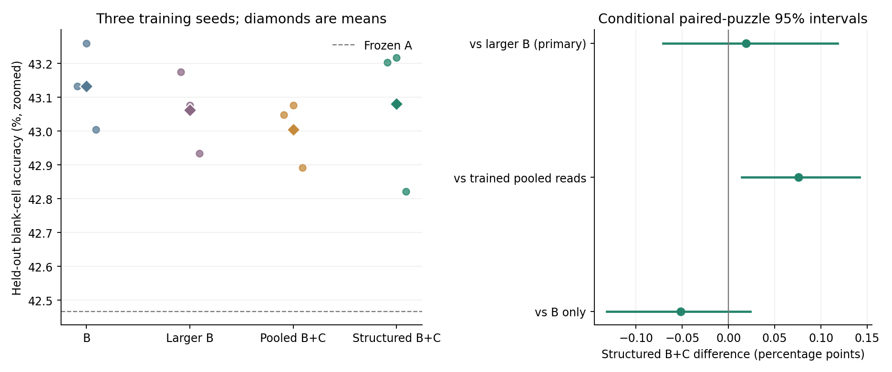
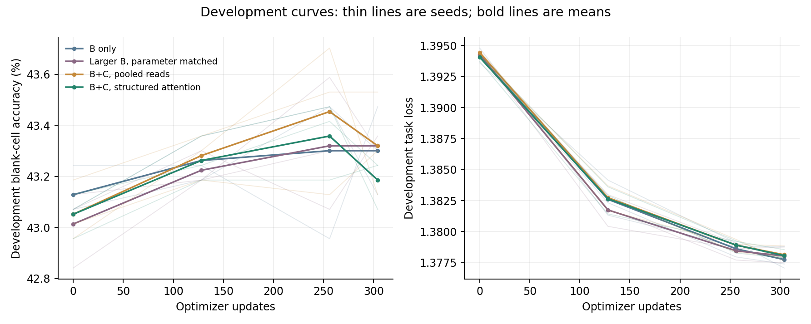

# Controlled test of inter-model attention

**This run did not establish an accuracy advantage for structured inter-model attention over the parameter-matched larger-B control.**

The predeclared primary comparison is structured B+C versus an active,
parameter-matched larger B. Its mean difference was **+0.019
percentage points**, with conditional paired-puzzle 95% interval
**[-0.071, +0.118]**.

## Final held-out results

Blank-cell accuracy is evaluated on 128 official test puzzles at
offset 1024, using all 16 ACT updates per puzzle. Frozen A alone
scored **42.467%**. Controller results average seeds [29, 43, 59].

| Trained system | Trainable parameters | Blank-cell accuracy | Task loss |
|---|---:|---:|---:|
| B only | 348,128 | 43.132% | 1.348735 |
| Larger B, parameter matched | 377,296 | 43.061% | 1.348586 |
| B+C, pooled reads | 377,296 | 43.005% | 1.348783 |
| B+C, structured attention | 377,296 | 43.080% | 1.348852 |

| System | Seed 29 | Seed 43 | Seed 59 |
|---|---:|---:|---:|
| B only | 43.132% | 43.260% | 43.005% |
| Larger B, parameter matched | 43.175% | 43.076% | 42.934% |
| B+C, pooled reads | 43.047% | 43.076% | 42.892% |
| B+C, structured attention | 43.203% | 43.217% | 42.821% |

No evaluated variant produced a complete valid puzzle solution.



## Protocol and executed budget

A was fixed at the same native-training checkpoint for every run. The experiment
does not train A or test whether joint A training makes A more adaptable. B writes
complete dense temporary changes to A's two MLP down-projections. C cross-attends
to 14 internal B tokens and writes a dense temporary change to B's generation
head. There are no low-rank factors in the tested models.

Fresh weights were generated before each of the 21 reasoning calls per ACT, including all 14 native no-gradient warm-up calls: 336 generations per complete puzzle. Each of the final seven calls has its own differentiable B/C write.

Each of the 12 training runs received **304 updates**, batch
**16**, identical data/augmentation and native A-call budgets
within each seed. This admitted **304 augmented puzzles per arm** from
a 3584-puzzle pool. Pooled and structured C had exactly identical
initial parameters. The larger-B control spent C's 29,168-parameter budget on
an active context network, rather than unused parameter padding. Its total
trainable count exactly matches B+C. Total FLOPs and wall-clock costs are not
identical; the matched compute boundary is the number of A calls.

The 32-puzzle development panel and held-out test panel are disjoint
from controller training. Exact puzzle and solution hashes of the final test panel were checked against every split of the previous cache; the panel starts beyond that cache's test prefix. The frozen A donor's original training pool was verified unchanged. Hyperparameters and the primary comparison were fixed
before study evaluation. A training-only throughput profile selected
304 updates from a requested 960 to respect
the **60-minute cap**, with a 50% timing margin. Profile
models were discarded. Every reported checkpoint is the final training step;
development scores were not used to choose checkpoints. No oracle was used.

The comparison completed in **30.49 minutes**.
All 12 arms completed. The local suite passed 135 tests before the
run. The independent saved-artifact audit passed **1192/1192**
checks, including all native A tensors unchanged, common initialization,
regenerated augmented streams, exact parameter matching, snapshot hashes,
prediction-derived accuracy and independently calculated Stablemax task loss.
The auditor does not replay optimizer steps or model inference.

## Development learning curves

All arms were measured at updates [0, 128, 256, 304]. Intermediate evaluations
follow complete 16-ACT episodes; the next training episode resets all puzzle
slots, preserving the matched training stream. Every final test score uses the
last checkpoint, with no development-based selection or early stopping.



Structured B+C development loss changed from 1.394058
to 1.378062; its blank accuracy changed from
43.052% to
43.186%. These measurements describe
the executed budget and do not establish convergence or predict a longer run.

## Paired effects and inference ablations

Positive values favor normal structured B+C. C ablations use the same trained
checkpoint and do not replace separately trained controls. The pooled trained
arm is the matched experiment for whether the structured read interface helps.

| Comparison | Mean difference (pp) | Conditional 95% interval (pp) |
|---|---:|---:|
| cross-minus-larger_b | +0.019 | [-0.071, +0.118] |
| cross-minus-pooled | +0.076 | [+0.014, +0.142] |
| cross-minus-b | -0.052 | [-0.132, +0.024] |
| cross-minus-c_off | +0.014 | [-0.047, +0.080] |
| cross-minus-c_read_shuffle | +0.033 | [-0.043, +0.118] |

The intervals resample held-out puzzles after averaging these three fixed seeds.
They do not capture uncertainty from retraining A or the full distribution of
controller training outcomes. Secondary intervals are descriptive and are not
adjusted for multiple comparisons. Only one A donor, a bounded controller budget
and one Sudoku test panel were evaluated. Nonzero attention gradients or distinct
attention maps do not demonstrate useful specialization, reasoning transparency
or safety. Exact-puzzle results and each inference condition remain in summary.json.

## Reproduction

Copy `local_lab/config_per_step_test.json` with fresh `results_dir` and
`profile_file` paths; existing runs are never overwritten. Then run:

```powershell
& '..\plastic-latent-lab\.venv\Scripts\python.exe' -m local_lab.attention_test --config local_lab/config_per_step_test.json --stage all
& '..\plastic-latent-lab\.venv\Scripts\python.exe' scripts/verify_attention_test.py --run results/per_step_comparison_20261102_v4
& '..\plastic-latent-lab\.venv\Scripts\python.exe' -m local_lab.attention_report --run results/per_step_comparison_20261102_v4
```

## Matched cadence follow-up

The exploratory matched comparison scored 43.080% with per-reasoning-step weights and 42.797% with the old once-per-ACT timing. The paired difference is +0.283 percentage points, conditional 95% interval [+0.019, +0.563]. Initial actor tensors, data streams, optimizer/A-call budgets and A weights matched. Controller computation and total FLOPs differ. This follow-up does not change the predeclared primary comparison or establish a C-over-B benefit. See [the cadence-control report](cadence_comparison.md) and its tensor-identity checks.
